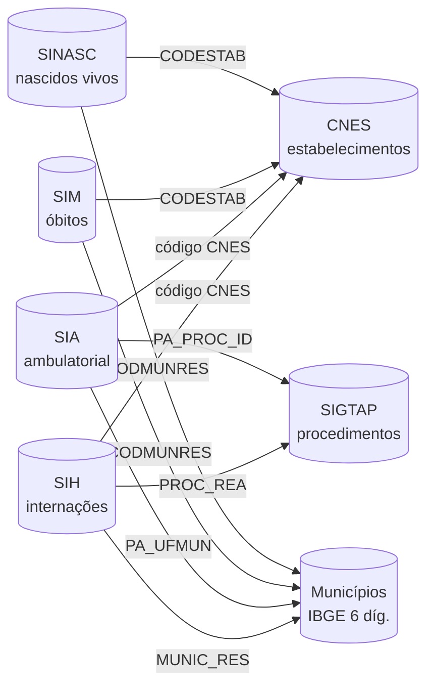

<div align="center">

# 🩺 Guia de Dados Públicos do SUS

**Biblioteca consultável para quem vai começar a trabalhar com SIH, SIA, SIM, SINASC e CNES — onde está cada base, o que significa cada variável e quais armadilhas evitar.**


[📒 Notebook público](#-entregáveis) · [📚 Catálogo](catalogo/catalogo-bases.md) · [🧪 Avaliação](avaliacao/perguntas-teste.md) · [⚠️ Armadilhas](docs/armadilhas.md)

</div>

---

## 🎯 Problema

Quem começa a trabalhar com dados do SUS perde **semanas** descobrindo em que pasta do FTP está cada base, por que o número de internações não bate com o TabNet e se pode ou não cruzar duas bases sem violar a LGPD.

## 💡 Solução

| Peça | O que entrega |
|---|---|
| **Catálogo** (`catalogo/`) | 16 bases e tabelas auxiliares com granularidade, periodicidade, cobertura, **chave de ligação**, link de download e dicionário |
| **Notebook no NotebookLM** | Fontes oficiais curadas (dicionários DATASUS, LGPD, portarias, RNDS) para perguntar em linguagem natural com citação |
| **Avaliação** (`avaliacao/`) | 20 perguntas-teste com gabarito conferido na fonte + registro de **onde a ferramenta errou e por quê** |
| **Guias** (`docs/`) | Armadilhas por base e resumo de LGPD/interoperabilidade |
| **Automação** (`scripts/`) | Download automático dos dicionários do FTP, geração do catálogo e verificação semanal de links |

**Usuário:** analista ou pesquisador.
**Decisão apoiada:** *qual base usar e como interpretá-la corretamente.*

## 🗂️ Bases cobertas

| Sistema | Registra | Granularidade | Periodicidade | Chave de ligação |
|---|---|---|---|---|
| **SIH/SUS** | Internações (AIH) | UF · município | Mensal | CNES, município, CID-10, SIGTAP |
| **SIA/SUS** | Produção ambulatorial (BPA, APAC, RAAS) | UF · estabelecimento | Mensal | CNES, município, SIGTAP |
| **SIM** | Óbitos (DO) | UF · município | Anual | Município, CNES, CID-10 |
| **SINASC** | Nascidos vivos (DN) | UF · município | Anual | Município, CNES |
| **CNES** | Estabelecimentos, leitos, profissionais | UF · estabelecimento | Mensal | CNES, município, CBO |

➡️ Detalhes completos em **[catalogo/catalogo-bases.md](catalogo/catalogo-bases.md)** (ou `.csv` para uso em código).

## 🧭 Como as bases se conectam



> Nos microdados públicos **não há identificador de pessoa** — as ligações são por estabelecimento, território, procedimento e diagnóstico, nunca por indivíduo.

## 📦 Entregáveis

| Entregável | Link |
|---|---|
| 📒 Notebook público no NotebookLM | _cole aqui o link de compartilhamento_ |
| 🎧 Resumo em áudio gerado pela ferramenta | _cole aqui o link ou `notebooklm/resumo-audio.mp3`_ |
| 📚 Catálogo em Markdown | [catalogo/catalogo-bases.md](catalogo/catalogo-bases.md) |
| 🧪 20 perguntas-teste + placar | [avaliacao/perguntas-teste.md](avaliacao/perguntas-teste.md) |
| 🔍 Onde a ferramenta errou | [avaliacao/registro-de-erros.md](avaliacao/registro-de-erros.md) |

## 🧪 Resultados da avaliação

| Métrica | Resultado |
|---|---|
| Respostas corretas e bem citadas (✅) | __/20 |
| Parcialmente corretas (⚠️) | __/20 |
| Erradas ou sem citação (❌) | __/20 |
| Pergunta de controle (resposta fora das fontes) | _recusou / alucinou_ |

**Principais achados:** _preencha após o teste — ex.: "a ferramenta confundiu competência com data de internação (G2)"._

## 🚀 Como reproduzir

```bash
git clone https://github.com/SEU-USUARIO/guia-dados-sus.git
cd guia-dados-sus

# 1. Baixar os dicionários e manuais oficiais do FTP do DATASUS (só biblioteca padrão)
python scripts/baixar_documentacao.py            # ou: SIM SINASC  |  --listar

# 2. Regenerar o catálogo após editar o CSV
python scripts/gerar_catalogo.py

# 3. Verificar se todos os links continuam no ar
python scripts/verificar_links.py
```

Depois, siga o **[roteiro do NotebookLM](notebooklm/roteiro.md)** para montar o notebook, gerar o áudio e rodar a avaliação.

## 🏗️ Estrutura

```
guia-dados-sus/
├── catalogo/
│   ├── catalogo-bases.csv        # fonte única da verdade
│   └── catalogo-bases.md         # gerado pelo script
├── fontes/
│   └── fontes-notebooklm.md      # o que subir no notebook e onde achar
├── avaliacao/
│   ├── perguntas-teste.md        # 20 perguntas + gabarito + placar
│   └── registro-de-erros.md      # taxonomia de erros da ferramenta
├── docs/
│   ├── armadilhas.md
│   └── lgpd-e-interoperabilidade.md
├── notebooklm/
│   └── roteiro.md                # passo a passo + prompts
├── scripts/
│   ├── baixar_documentacao.py
│   ├── gerar_catalogo.py
│   └── verificar_links.py
└── .github/workflows/verificar-links.yml   # checagem semanal automática
```

## 🧠 Decisões de curadoria

- **Fontes primárias primeiro:** dicionários do próprio DATASUS e textos oficiais das normas; materiais secundários só quando explicam regras que os dicionários omitem.
- **Avaliação com pergunta de controle:** uma pergunta cuja resposta *não* está nas fontes, para medir alucinação.
- **Taxonomia de erros** (fonte ausente, recuperação, alucinação, citação) para explicar *por que* a ferramenta errou — não só *se* errou.
- **CSV como fonte única:** o Markdown é gerado, evitando divergência entre versões.

## 🔁 Versões em outros nichos

A mesma estrutura serve para:
- **Educação:** microdados do INEP (Censo Escolar, ENEM, Saeb).
- **Agronegócio:** IBGE (PAM, PPM, Censo Agro) e Conab (safras, custos de produção).

## ⚖️ Aviso

Este guia **não** redistribui microdados; aponta para as fontes oficiais. Os microdados públicos do DATASUS são desidentificados — não tente reidentificar pessoas. Resumos de normas não substituem o texto legal vigente.

## 📄 Licença

Código sob **MIT**. Conteúdo textual (catálogo, guias e avaliação) sob **CC BY 4.0**.

## 👤 Autor

**Augusto Coelho** — Especialista em Ciência de Dados e Inteligência Artificial
[LinkedIn](https://www.linkedin.com/in/SEU-USUARIO) · [GitHub](https://github.com/SEU-USUARIO)
