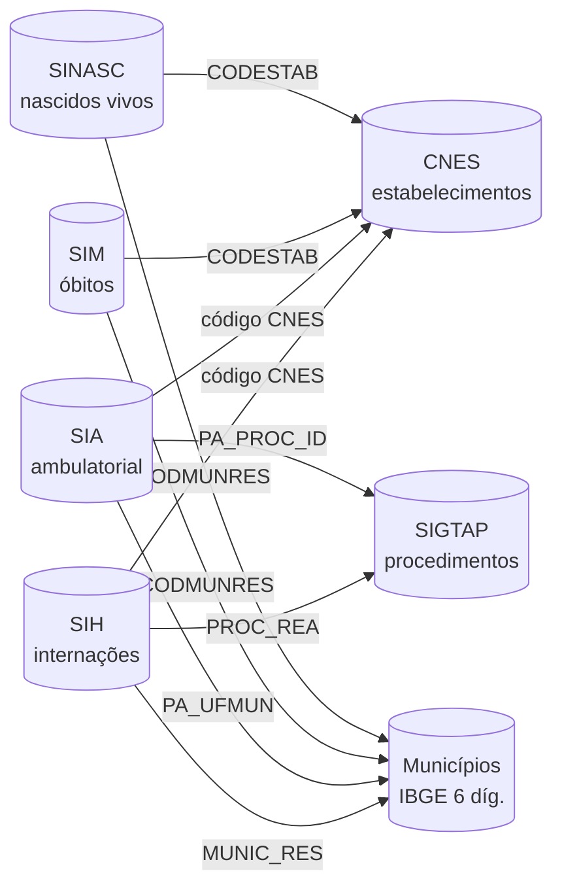

# Guia de Dados Públicos do SUS

Biblioteca consultável para quem vai começar a trabalhar com SIH, SIA, SIM, SINASC e CNES: onde está cada base, o que significa cada variável e quais armadilhas evitar.

[Notebook público](https://notebook.google.com/notebook/9c15012a-cc84-44fc-aada-5290c6ebc1e6) · [Catálogo](catalogo/catalogo-bases.md) · [Avaliação](avaliacao/perguntas-teste.md) · [Armadilhas](docs/armadilhas.md)

---

## Problema

Quem começa a trabalhar com dados do SUS perde **semanas** descobrindo em que pasta do FTP está cada base, por que o número de internações não bate com o TabNet e se pode ou não cruzar duas bases sem violar a LGPD.

## Solução

| Peça | O que entrega |
|---|---|
| **Catálogo** (`catalogo/`) | 16 bases e tabelas auxiliares com granularidade, periodicidade, cobertura, **chave de ligação**, link de download e dicionário |
| **Notebook no NotebookLM** | Fontes oficiais curadas (dicionários DATASUS, LGPD, portarias, RNDS) para perguntar em linguagem natural com citação |
| **Avaliação** (`avaliacao/`) | 20 perguntas-teste com gabarito conferido na fonte + registro de **onde a ferramenta errou e por quê** |
| **Guias** (`docs/`) | Armadilhas por base e resumo de LGPD/interoperabilidade |
| **Automação** (`scripts/`) | Download automático dos dicionários do FTP, geração do catálogo e verificação semanal de links |

**Usuário:** analista ou pesquisador.
**Decisão apoiada:** *qual base usar e como interpretá-la corretamente.*

## Bases cobertas

| Sistema | Registra | Granularidade | Periodicidade | Chave de ligação |
|---|---|---|---|---|
| **SIH/SUS** | Internações (AIH) | UF · município | Mensal | CNES, município, CID-10, SIGTAP |
| **SIA/SUS** | Produção ambulatorial (BPA, APAC, RAAS) | UF · estabelecimento | Mensal | CNES, município, SIGTAP |
| **SIM** | Óbitos (DO) | UF · município | Anual | Município, CNES, CID-10 |
| **SINASC** | Nascidos vivos (DN) | UF · município | Anual | Município, CNES |
| **CNES** | Estabelecimentos, leitos, profissionais | UF · estabelecimento | Mensal | CNES, município, CBO |

Detalhes completos em **[catalogo/catalogo-bases.md](catalogo/catalogo-bases.md)** (ou `.csv` para uso em código).

## Como as bases se conectam



> Nos microdados públicos **não há identificador de pessoa** — as ligações são por estabelecimento, território, procedimento e diagnóstico, nunca por indivíduo.

## Entregáveis

| Entregável | Link |
|---|---|
| Notebook público no NotebookLM | [notebook.google.com/notebook/9c15012a-…](https://notebook.google.com/notebook/9c15012a-cc84-44fc-aada-5290c6ebc1e6) |
| Resumo em áudio gerado pela ferramenta | [ouvir na Release do GitHub](https://github.com/augustocoelhoie/Guia-de-dados-publicos-SUS/releases/tag/SUS) · [transcrição](avaliacao/transcricao-audio.md) |
| Catálogo em Markdown | [catalogo/catalogo-bases.md](catalogo/catalogo-bases.md) |
| 20 perguntas-teste + placar | [avaliacao/perguntas-teste.md](avaliacao/perguntas-teste.md) |
| Onde a ferramenta errou | [avaliacao/registro-de-erros.md](avaliacao/registro-de-erros.md) |
| Fontes excluídas e por quê | [fontes/fontes-excluidas.md](fontes/fontes-excluidas.md) |

## Resultados da avaliação

Teste realizado em 13/11/2026, com instruções do notebook na versão 2 e apenas fontes primárias ativas.

| Métrica | Resultado |
|---|---|
| Respostas corretas e bem citadas (✅) | **14/20** |
| Corretas com ressalvas (⚠️) | **6/20** |
| Erradas ou inventadas (❌) | **0/20** |
| Pergunta de controle (resposta fora das fontes) | ✅ Recusou inventar e indicou onde buscar |
| Gabaritos corrigidos após conferência na fonte | **3/20** |
| Variáveis conferidas nos microdados reais | **todas encontradas** (cabeçalho de arquivos .dbc) |
| Afirmações do resumo em áudio | **14 ✅ · 12 ⚠️ · 1 ❌** (de 27) |

**Principais achados**
- **A documentação oficial também erra.** O informe técnico do SIH grafa `MÊS_CMPT` e `DI_INTER`; nos arquivos as colunas são `MES_CMPT` e `DT_INTER`. A ferramenta copiou fielmente os erros da fonte, e só a conferência nos microdados os revelou.
- **Fontes oficiais divergem entre si.** A codificação de `IDADE` do SIM para menores de 1 ano difere entre a estrutura da DO 2025 e o pacote microdatasus. Diante da lacuna, a ferramenta "completou" a regra (G2).
- **Citações literais podem vir alteradas.** Em duas respostas, palavras do texto original foram trocadas por equivalentes em inglês ("controlled", "applied", "converted"). O conteúdo estava certo, mas o trecho não pode ser copiado como citação.
- **A ferramenta foi honesta sobre lacunas.** Na pergunta de controle e no ano da CID-10 do SIM, declarou que a informação não estava nas fontes em vez de inventar.
- **Notas do próprio projeto viram autocitação.** Com elas ativas, a ferramenta citava o catálogo como evidência; por isso a avaliação usou só fontes primárias.
- **O áudio é bom para introdução, fraco para referência.** Acertou os pontos centrais (SP, RD/RJ, sub-registro, LGPD), mas atribuiu ao arquivo BI o papel do PA, acrescentou interpretações sem fonte e omitiu metade das armadilhas pedidas.
- **Parte da evidência está na estrutura do FTP**, não nos documentos (início do CNES em 08/2005, CID-10 no SIM desde 1996).

Detalhes: [placar e gabaritos](avaliacao/perguntas-teste.md) · [registro de erros](avaliacao/registro-de-erros.md) · [respostas brutas](avaliacao/respostas-notebooklm.md)

## Como usar

Escolha pelo que você precisa. Os três primeiros não exigem instalar nada.

| Quero… | Use | Como |
|---|---|---|
| **Tirar uma dúvida rápida** sobre uma base ou variável | [Notebook público](https://notebook.google.com/notebook/9c15012a-cc84-44fc-aada-5290c6ebc1e6) | Abra o link (precisa de conta Google) e pergunte em linguagem natural. Confira sempre a citação: a [avaliação](avaliacao/registro-de-erros.md) mostra onde a ferramenta erra. |
| **Escolher qual base usar** | [Catálogo](catalogo/catalogo-bases.md) | Leia a tabela-resumo e a ficha da base: granularidade, periodicidade, chave de ligação, link de download e a armadilha principal. |
| **Evitar erros na análise** | [Armadilhas](docs/armadilhas.md) e [LGPD](docs/lgpd-e-interoperabilidade.md) | Leia antes de cruzar bases ou publicar resultados. |
| **Usar o catálogo em código** | `catalogo/catalogo-bases.csv` | Python: `pd.read_csv("https://raw.githubusercontent.com/augustocoelhoie/Guia-de-dados-publicos-SUS/main/catalogo/catalogo-bases.csv")` · Excel: *Dados → Obter dados → Da Web* com o mesmo link. |
| **Baixar a documentação oficial** | `scripts/baixar_documentacao.py` | Clone o repositório e rode o script (ver [Como reproduzir](#como-reproduzir)). |
| **Montar um guia para outro tema** (INEP, IBGE, Conab…) | Fork do repositório | Clique em **Fork**, troque as linhas do CSV e as fontes, e siga o [roteiro do NotebookLM](notebooklm/roteiro.md) e as [perguntas-teste](avaliacao/perguntas-teste.md) como modelo. |

Encontrou um erro ou link quebrado? Abra uma **Issue** neste repositório.

## Como reproduzir

```bash
git clone https://github.com/augustocoelhoie/Guia-de-dados-publicos-SUS.git
cd Guia-de-dados-publicos-SUS

# 1. Baixar os dicionários e manuais oficiais do FTP do DATASUS (só biblioteca padrão)
python scripts/baixar_documentacao.py            # ou: SIM SINASC  |  --listar

# 2. Regenerar o catálogo após editar o CSV
python scripts/gerar_catalogo.py

# 3. Verificar se todos os links continuam no ar
python scripts/verificar_links.py

# 4. Conferir nos microdados reais se as variáveis citadas existem
python scripts/conferir_variaveis.py
```

Depois, siga o **[roteiro do NotebookLM](notebooklm/roteiro.md)** para montar o notebook, gerar o áudio e rodar a avaliação.

## Estrutura

```
Guia-de-dados-publicos-SUS/
├── catalogo/
│   ├── catalogo-bases.csv        # fonte única da verdade
│   └── catalogo-bases.md         # gerado pelo script
├── fontes/
│   ├── fontes-notebooklm.md      # o que subir no notebook e onde achar
│   └── fontes-excluidas.md       # o que ficou de fora e por quê
├── avaliacao/
│   ├── perguntas-teste.md        # 20 perguntas + gabarito + placar
│   ├── respostas-notebooklm.md   # respostas brutas da ferramenta (evidência)
│   ├── transcricao-audio.md      # transcrição do resumo em áudio
│   └── registro-de-erros.md      # taxonomia de erros da ferramenta
├── docs/
│   ├── armadilhas.md
│   └── lgpd-e-interoperabilidade.md
├── notebooklm/
│   └── roteiro.md                # passo a passo + prompts
├── scripts/
│   ├── baixar_documentacao.py
│   ├── conferir_variaveis.py
│   ├── gerar_catalogo.py
│   └── verificar_links.py
└── .github/workflows/verificar-links.yml   # checagem semanal automática
```

## Decisões de curadoria

- **Fontes primárias primeiro:** dicionários do próprio DATASUS e textos oficiais das normas; materiais secundários só quando explicam regras que os dicionários omitem.
- **Avaliação com pergunta de controle:** uma pergunta cuja resposta *não* está nas fontes, para medir alucinação.
- **Taxonomia de erros** (fonte ausente, recuperação, alucinação, citação) para explicar *por que* a ferramenta errou — não só *se* errou.
- **CSV como fonte única:** o Markdown é gerado, evitando divergência entre versões.

## Método de validação e limitações

**Como as respostas foram validadas**
1. Cada gabarito foi conferido na **fonte primária** (dicionário DATASUS, texto da lei ou portaria), com documento e página registrados no placar.
2. Quando o gabarito divergiu da fonte, **a fonte prevaleceu** e a correção foi registrada.
3. Os nomes de variáveis foram conferidos também **nos próprios microdados** (cabeçalho de arquivos .dbc reais do Acre; todas encontradas em 13/11/2026).
4. Uma pergunta de controle mede se a ferramenta **inventa respostas** fora das fontes.

**Limitações**
- Amostra pequena (20 perguntas) e avaliador único: serve como diagnóstico, não como medida estatística de acurácia.
- As perguntas foram escritas por quem conhecia as fontes, o que pode favorecer a ferramenta.
- Parte da documentação oficial é antiga (ex.: informe técnico do SIH de 2016); regras podem ter mudado desde então.
- Resultados válidos para a versão do NotebookLM e das fontes na data do teste: 13/11/2026.
- Projeto elaborado com apoio de IA generativa na redação; todo o conteúdo factual foi conferido manualmente nas fontes citadas.

## Versões em outros nichos

A mesma estrutura serve para:
- **Educação:** microdados do INEP (Censo Escolar, ENEM, Saeb).
- **Agronegócio:** IBGE (PAM, PPM, Censo Agro) e Conab (safras, custos de produção).

## Aviso

Este guia **não** redistribui microdados; aponta para as fontes oficiais. Os microdados públicos do DATASUS são desidentificados: não tente reidentificar pessoas. Resumos de normas não substituem o texto legal vigente.

## Licença

Código sob **MIT**. Conteúdo textual (catálogo, guias e avaliação) sob **CC BY 4.0**.

## Autor

**Augusto César A. A. Coelho**, especialista em Ciência de Dados e Inteligência Artificial

[LinkedIn](https://www.linkedin.com/in/augusto-c%C3%A9sar-coelho-8335561a8/) · [GitHub](https://github.com/augustocoelhoie)
